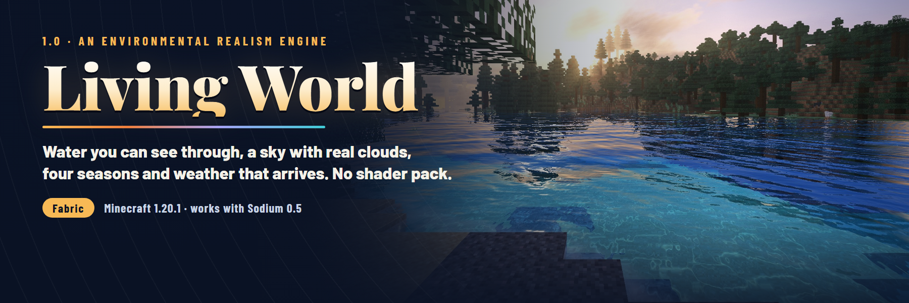

**[Docs](https://nightbeam.dev/docs/living-world) · [Discord](https://discord.gg/TJc3CxR4jK) · [Source and issues](https://github.com/MeherBenSalem/WeatherMod)**

## Weather, water, sky and seasons that belong to one world

**Living World** runs one simulation of the air around you (temperature, humidity, wind, rain, ground wetness, shelter)
and lets everything you see and hear read from it. Water is see-through and mirrors the trees and the clouds. The
clouds are three-dimensional, drift with the wind and shade the land. The year turns through four seasons. Rain
arrives the way weather does, and the ground, the grass and your footprints answer it.

No shader pack is needed, and on 1.20.1 it works with Sodium (Fabric) and Embeddium (Forge).

Minecraft 1.20.1 on Fabric and Forge · 1.21.1, 26.2 and 26.3 on Fabric and NeoForge · runs on the client alone, on any server · needs Fabric API on Fabric · Mod Menu is optional

**On 26.2 and 26.3** the game's new renderer leaves no place for the mod's own shaders, so the see-through water, the 3D clouds, the sky and fog colours, swaying plants and the atmosphere effects (mist, wet ground, light shafts, colour grading) are not drawn there. The weather, seasons, wind, rain and snow, footprints, frost, sound, camera effects and every gameplay rule work as on the other versions.

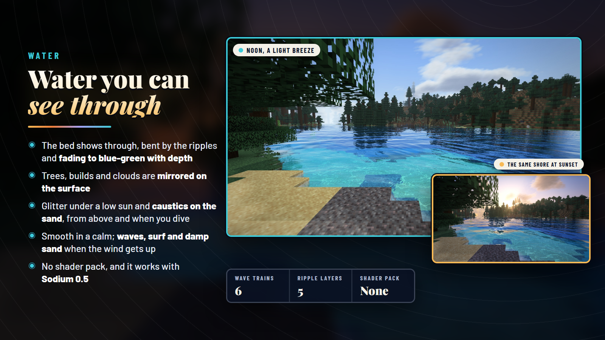

- **See-through water.** You see the bed through it, bent by the ripples and fading to blue-green with depth.
- **Reflections.** Trees, hills and builds are mirrored on the surface (Balanced preset and up), and so are the
  clouds, taken from the same cloud field you see overhead.
- **Light.** Glitter under a low sun or moon, and caustics on the bed, from above and when you dive.
- **Wind.** In still air water lies nearly smooth under slow ripples. Wind raises waves, carries the ripples downwind
  and sends surf up the shore. The surface is built from 6 wave trains and 5 layers of ripples.
- **The shoreline.** Foam where water meets land, and sand along the waterline that stays dark and damp.

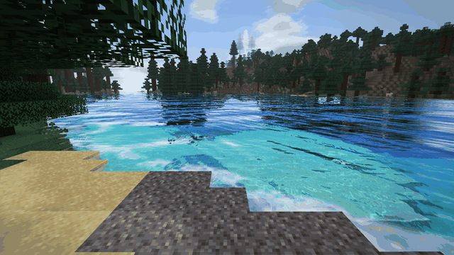

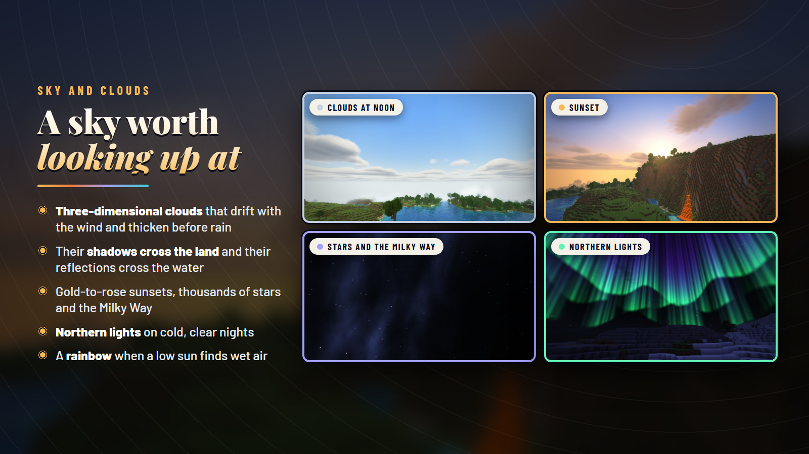

- **Clouds with depth** replace the game's flat ones. They are lit by the sun or the moon, drift with the wind, come
  and go in fair weather, close over before rain and tower in a storm.
- **Cloud shadows** cross the land, and the same clouds are mirrored in water and puddles.
- **Sunsets** from gold to rose toward the sun, with a dusky pink band opposite it.
- **Night:** thousands of twinkling stars and the Milky Way, added to the game's own stars.
- **Northern lights** over cold, clear nights, and a **rainbow** opposite a low sun while the air is wet.
- *Fog & Atmosphere → Volumetric clouds* gives the game's own clouds back. "Clouds: Off" in the video settings turns
  both off.

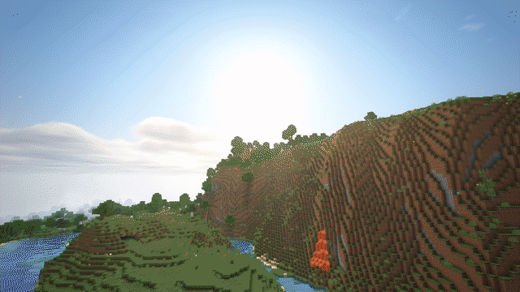

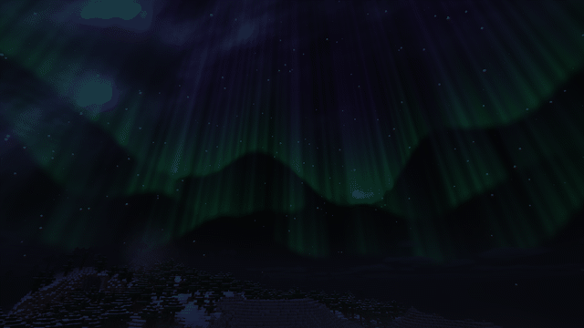

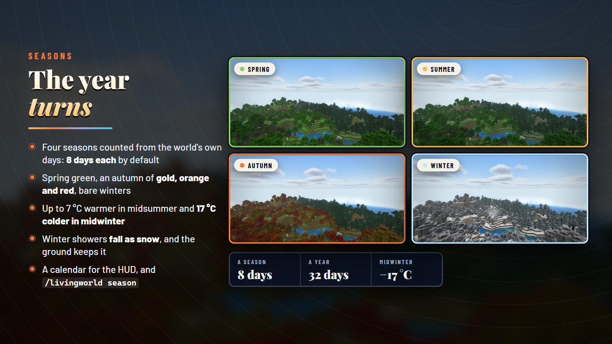

| Season | What you see | The climate |
|---|---|---|
| Spring | pale new green, the odd tree in blossom | mild |
| Summer | full green | up to 7 °C warmer at midsummer |
| Autumn | gold, orange and red, tree by tree; more leaves fall, in the colours the trees have turned | cooling |
| Winter | bare, bleached foliage; snow lying on the ground | up to 17 °C colder at midwinter; showers fall as snow |

- A season lasts **8 Minecraft days** by default. `/livingworld season length <days>` changes it.
- The calendar follows the world's own day counter, so every player agrees on the season, even on a vanilla server.
- The seasons are strongest in temperate biomes, weaker in deserts and almost absent in jungles. Conifers stay green.
- `/livingworld season` tells you the date. `/livingworld season set <spring|summer|autumn|winter>` jumps to one.
- *Climate & Temperature → Calendar* shows the season and the day on your HUD:

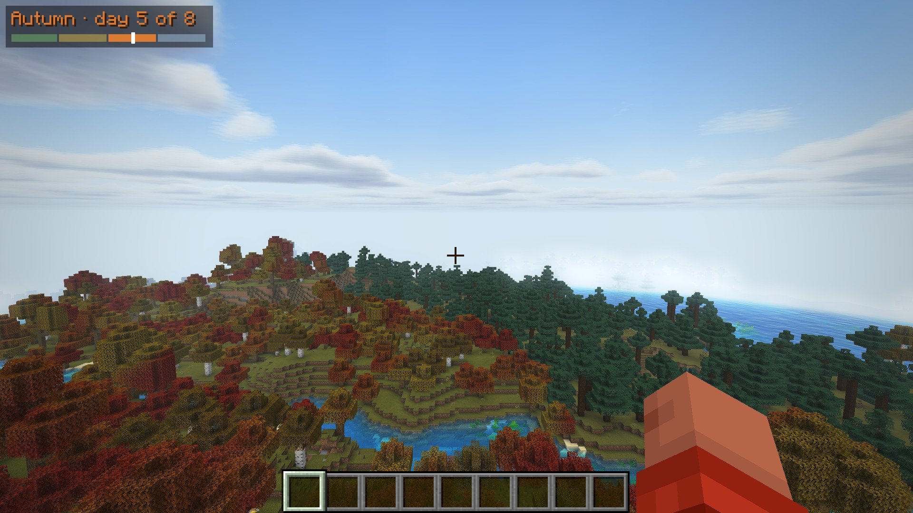

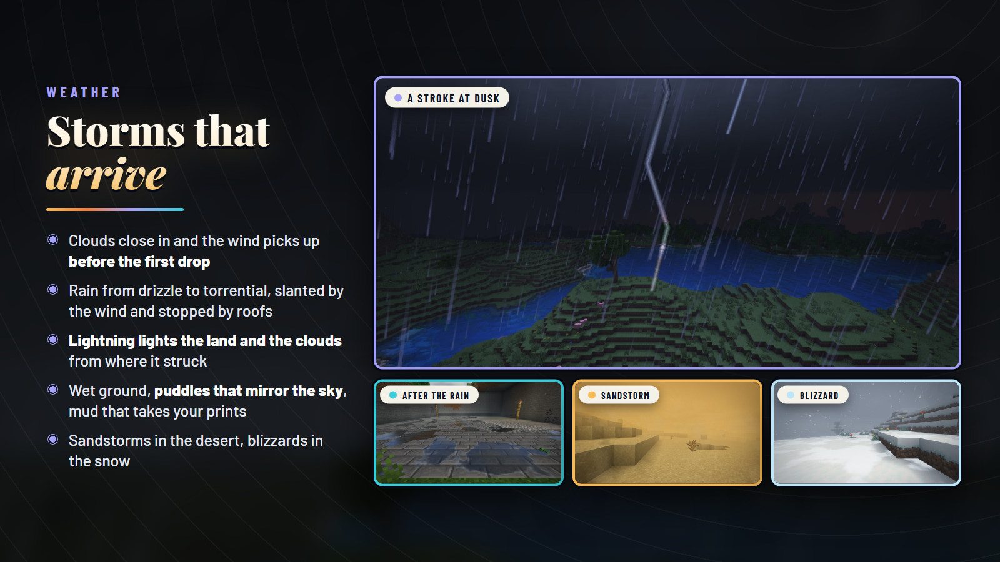

- **A storm builds.** Clouds close in, the wind picks up, the first drops fall. With the mod on the server too, the
  clouds start to gather up to two minutes before the rain.
- **Rain** from drizzle to torrential, slanted and gusting with the wind. Roofs stop it and tree canopies let a little
  through. Splashes differ on stone, soil, leaves and water.
- **Lightning** lights the land that faces it and the cloud above it, from the place it struck. Thunder follows after
  a delay that grows with distance.
- **Wet ground** darkens where rain can reach it and stays dry under cover. **Puddles** collect on ground that holds
  water and mirror the sky. Soaked dirt and grass turn to mud.
- **Sandstorms** in the desert: a wall of dust, sand streaming over the ground, almost no visibility.
- **Blizzards** in the snow: flakes flying sideways and a whiteout a few dozen blocks deep.
- **Fog and mist:** morning mist in valleys, haze over hot sand, low fog in swamps. It never closes in completely.

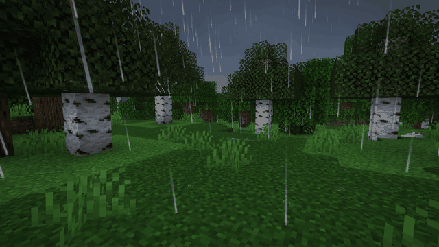

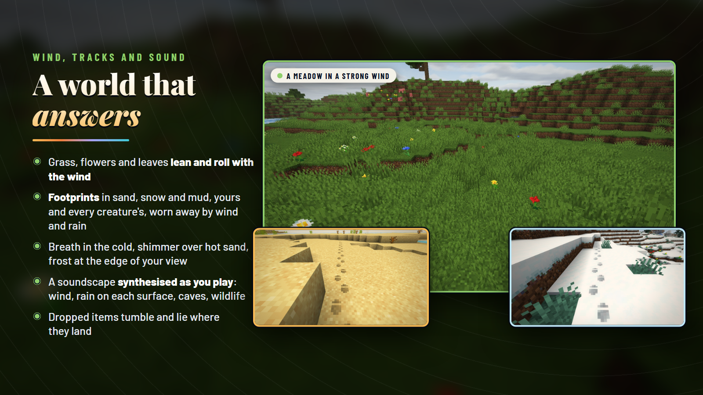

- **Wind you can see.** Grass, flowers and leaves lean and roll with it. Gusts cross a field at the wind's own pace
  and stop when it does.
- **Footprints** in sand, snow and mud, and wet prints on stone after a swim. Sprinting, sneaking and landing leave
  different marks. Animals leave hoof, paw and bird tracks.
- **Prints wear away.** Wind, rain, snowfall and sandstorms erase them, each surface at its own rate.
- **Your own body.** Breath in the cold, shimmer over hot ground, frost creeping over the edge of your view, drops on
  the lens in rain.
- **Sound.** Wind, rain on each kind of surface, caves, surf and wildlife are synthesised while you play. There is
  not one audio file in the jar. A resource pack can supply recordings for the birds and frogs.
- **Dropped items** tumble through the air and lie where they land.

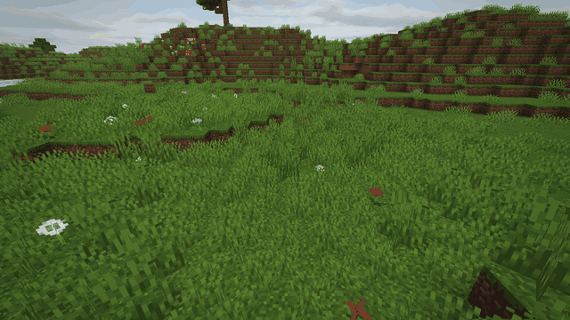

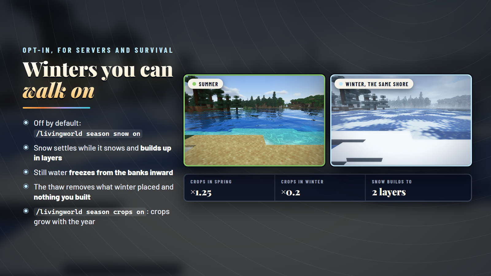

By default the mod changes nothing in your world: everything above is drawn or played on the client. Two rules go
further. Both are **off** until a server operator (or you, in single-player) turns them on.

| Rule | Turn it on | What it does |
|---|---|---|
| Winter changes the world | `/livingworld season snow on` | Where the season makes it cold enough, snow settles while it snows and builds up to 2 layers, and still water freezes from the banks inward. The thaw takes away what winter placed and nothing else: your own snow and ice stay. |
| Crops follow the year | `/livingworld season crops on` | Crops, stems, saplings, sweet berry bushes and cocoa grow 25 % faster in spring, as in vanilla in summer, at 70 % to 60 % in autumn and at 20 % in winter. Plants under a roof are left alone, so a greenhouse works. |

Heat and cold are feedback, with one more opt-in: *Survival temperature rules* add mild hunger drain and slowness in
extreme heat or cold. They never deal damage.

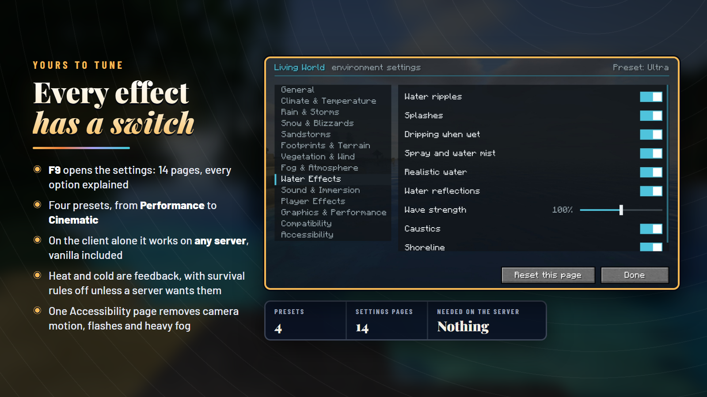

Press **F9** in the game, run `/lw config`, or use Mod Menu. There are 14 pages and every option has a description.

| Preset | Particles | Rain and snow streaks | Footprints | Water reflections | Cloud layer |
|---|---|---|---|---|---|
| Performance | 1,200 | 1,200 | 256 | the sky only | 8 slices, at half resolution |
| Balanced (default) | 3,000 | 3,200 | 768 | 14 steps | 16 slices, at half resolution |
| Ultra | 6,000 | 6,000 | 1,536 | 20 steps | 22 slices |
| Cinematic | 12,000 | 10,000 | 3,072 | 26 steps | 32 slices |

- The numbers are hard limits, so a storm cannot spawn its way into a stutter.
- *Adaptive quality* sheds particle density when you drop below your target frame rate.
- *Accessibility* is one page to remove camera motion, flashes, distortion, heavy fog, dense particles and overlays.
- `/livingworld weather <type>` and `/livingworld wind set <0..1.6>` let an operator stage any weather for everyone.
  `/lw` does the same for you alone, on any server.

| Setup | What you get |
|---|---|
| Client only, any server | Every visual and sound. Wind, weather and season come from the world's own time, so players with the mod still see the same thing. |
| Client and server | The same, plus commands everyone sees, clouds that gather before the rain, a season length the server decides, and the opt-in rules above. |
| Server only | The commands and the opt-in rules. Vanilla clients can join. |
| Sodium 0.5.x (1.20.1 Fabric), Embeddium (1.20.1 Forge) | Supported, tested with Sodium 0.5.11. Water, vegetation sway and seasonal colours work as on the vanilla renderer. On 1.21.1 Sodium runs, but the water, sway and seasonal colours are not drawn on the terrain it renders. |
| Iris with a shader pack | The pack is left in charge of water, sky and post-processing. Rain, snow, particles, footprints, fog distance and sound keep working. Not tested with a pack loaded. |
| Biome and block mods | Biomes are classified from their tags, temperature and rainfall, and blocks from their tags and step sound, so modded sand, snow and mud take footprints. |

**Do I need a shader pack?** No. Everything is drawn with the game's own renderer, or with Sodium's.

**Does the server need it?** No. On the client alone it works on any server, including vanilla ones.

**Does it change my world?** Not unless you turn on the winter rule. Without it the mod places and removes no blocks.

**Will it hurt my frame rate?** Water and clouds are the costly parts. The Performance preset drops water reflections
and draws the clouds with fewer slices, and each of them has its own switch.

**Does it work with shader packs?** With a pack active the mod steps back and lets the pack draw water and sky.

**The water is not see-through for me.** Check *Water Effects → Realistic water*, and that no resource pack replaces
the terrain shaders. With Sodium you need a 0.5.x build on 1.20.1. On 26.2 and 26.3 the water is drawn by the game itself.

**Can I use it in my modpack?** Yes. It is MIT-licensed and needs nothing beyond Fabric API on Fabric (nothing at all on Forge and NeoForge).

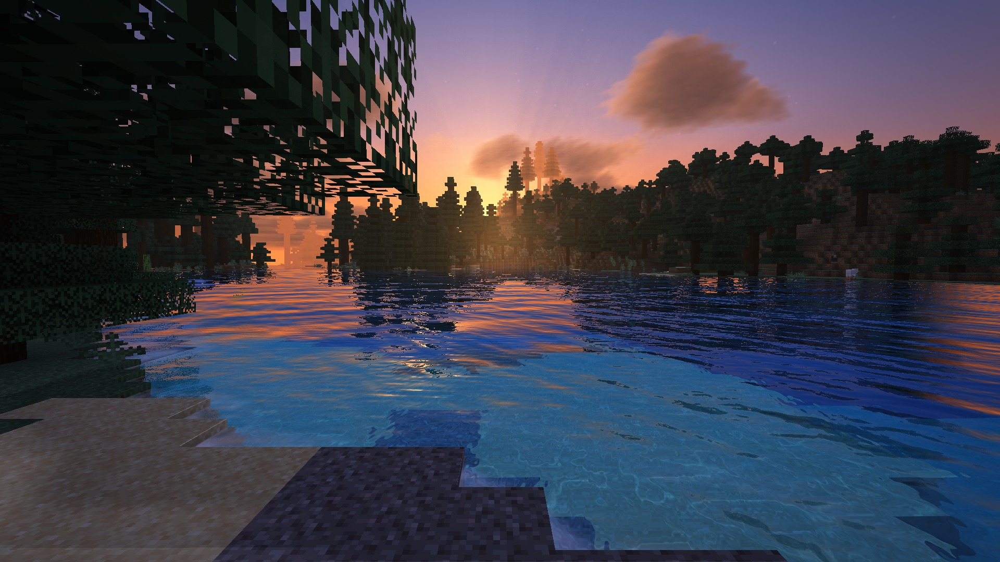

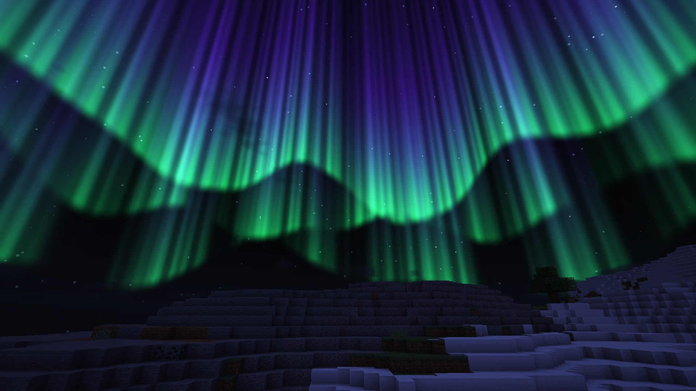

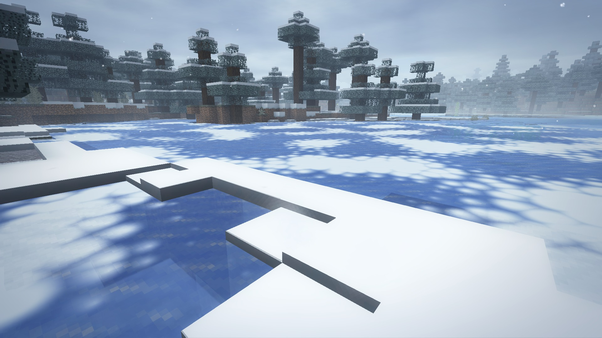

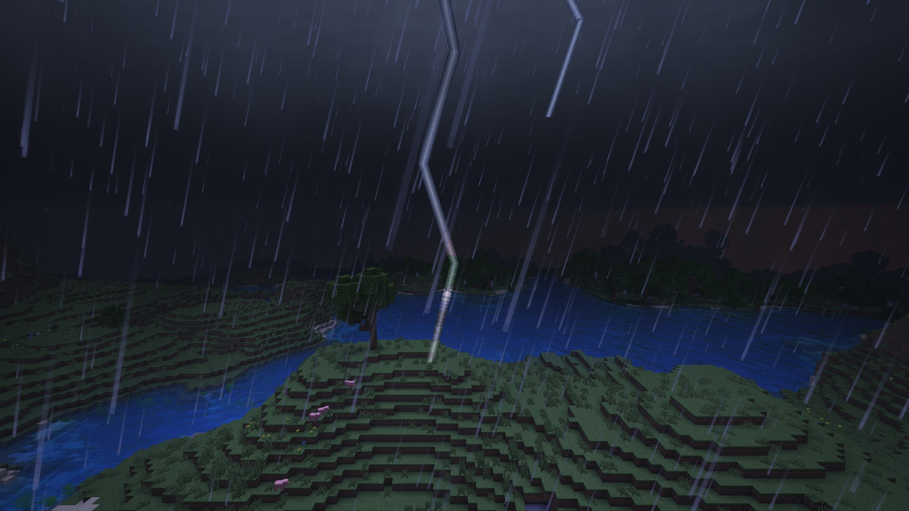

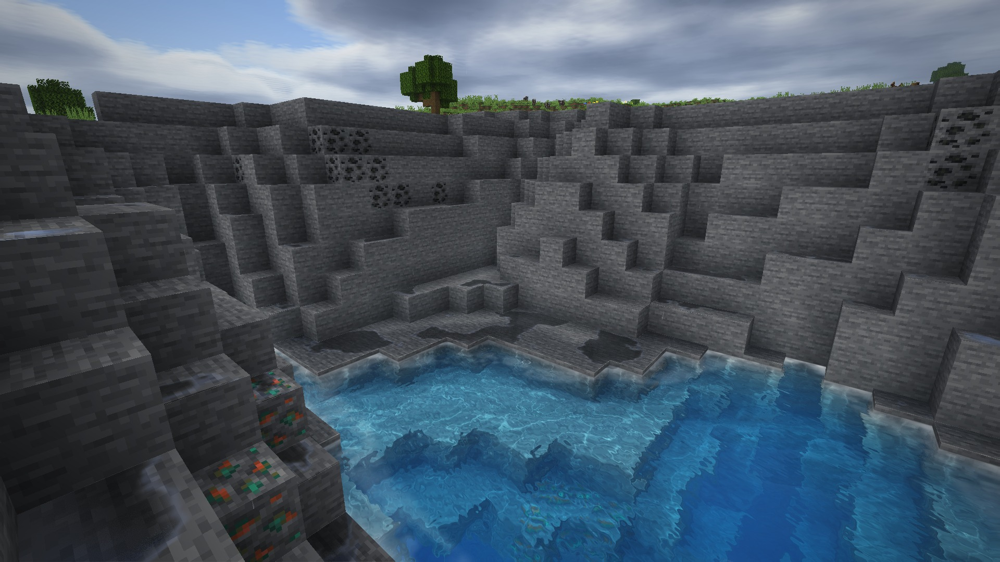

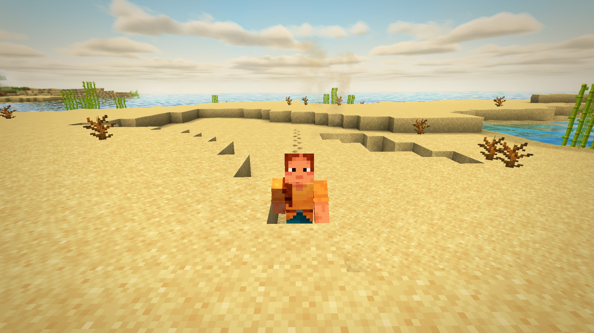

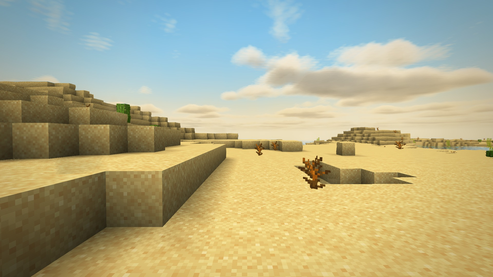

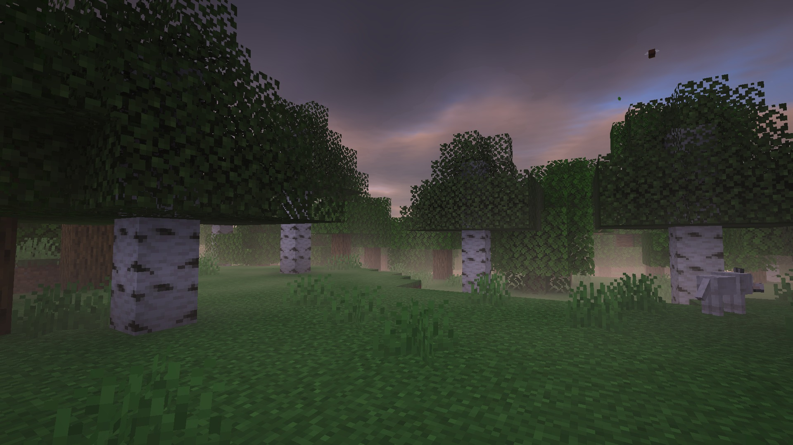

---

### More from NightBeam Studio

- **[Remnants: Ashen Legacy](https://www.curseforge.com/minecraft/modpacks/remnants-ashen-legacy)**: the story-driven soulslike RPG modpack built on NightBeam's mods
- **[Premium server plugins](https://nightbeam.dev/store)**: anti-cheat, ranked PvP, SMP setups and more on BuiltByBit
- **[NightBeam Pro](https://nightbeam.dev/memberships)**: the model library and NightBeam Forge credits, from $5 a month
- **[Discord](https://discord.gg/TJc3CxR4jK)**: support, bug reports, suggestions and early looks
- **[Support NightBeam](https://nightbeam.dev/support)**: help keep every mod free

**Follow:** [YouTube](https://www.youtube.com/@nightbeamstudio) · [Instagram](https://www.instagram.com/nightbeamstudio/) · [X](https://x.com/NightBeamLLC) · [Facebook](https://www.facebook.com/profile.php?id=61574823331471)
